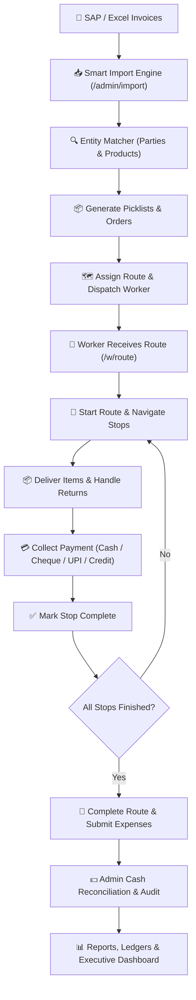

# 🚚 DistroTrack

### Enterprise Distribution Management System (DMS) for Wholesale FMCG Operations

[](https://react.dev/)
[](https://www.typescriptlang.org/)
[](https://vitejs.dev/)
[](https://tailwindcss.com/)
[](https://supabase.com/)
[](#)

**DistroTrack** is a modern, high-performance web platform engineered specifically for wholesale FMCG (Fast-Moving Consumer Goods) distributors and stockists. It bridges traditional, paper-heavy warehouse operations with field logistics by digitizing the complete distribution lifecycle: from parsing ERP/SAP picklists and managing customers (parties) to dispatching routes, collecting multi-mode payments, tracking worker expenses, and generating real-time executive analytics.

---

## 📑 Table of Contents

- [Overview & Value Proposition](#-overview--value-proposition)
- [System Architecture & Roles](#-system-architecture--roles)
- [Key Features & Modules](#-key-features--modules)
  - [👑 Master Super-Admin Portal](#1--master-super-admin-portal-master)
  - [🏢 Admin / Owner Operations Portal](#2--admin--owner-operations-portal-admin)
  - [📱 Worker Field Mobile Portal](#3--worker-field-mobile-portal-w)
- [End-to-End Operational Workflow](#-end-to-end-operational-workflow)
- [Technology Stack](#-technology-stack)
- [Database & Security Architecture](#-database--security-architecture)
- [Project Directory Structure](#-project-directory-structure)
- [Getting Started & Local Setup](#-getting-started--local-setup)
- [Database Setup & Migrations](#-database-setup--migrations)
- [User Onboarding & Secure Credential Setup](#-user-onboarding--secure-credential-setup)
- [Deployment Guide](#-deployment-guide)
- [Contributing & License](#-contributing--license)

---

## 💡 Overview & Value Proposition

Traditional FMCG distribution networks face significant operational bottlenecks:
- **Manual Data Entry:** Paper-based SAP picklists and physical invoices require hours of error-prone manual re-entry.
- **Lost Visibility:** Once delivery vans leave the warehouse, managers have zero real-time insight into delivery statuses, partial drops, or returns.
- **Cash & Cheque Leakage:** Reconciling cash collections, cheques, UPI transfers, and customer credit at the end of the day is chaotic and slow.
- **Uncoordinated Routes:** Inefficient stop sequencing increases vehicle fuel expenses and delivery turnaround times.

**DistroTrack transforms these operations by providing:**
1. **Zero-Friction Ingestion:** Instant PDF & Excel parsing for SAP Picklists and Sales Invoices (e.g., Colgate, Unilever, P&G format exports).
2. **Real-Time Synchronized Delivery Tracking:** Stop-by-stop checklist with instant status sync between field delivery workers and the back-office admin dashboard.
3. **Comprehensive Payment & Ledger Tracking:** Full audit of Cash, Cheque, UPI, and Credit payments with worker cash-in-hand reconciliation.
4. **Three-Tier Role Management:** Dedicated interfaces for Super-Admins (Master), Warehouse/Business Owners (Admin), and Delivery Drivers/Field Agents (Workers).

---

## 👥 System Architecture & Roles

DistroTrack provides three purpose-built interfaces tailored to each stakeholder's responsibilities:

```
                               ┌─────────────────────────────────┐
                               │       DistroTrack Gateway       │
                               │         (PIN / Auth)            │
                               └────────────────┬────────────────┘
                                                │
                 ┌──────────────────────────────┼──────────────────────────────┐
                 ▼                              ▼                              ▼
      ┌──────────────────────┐      ┌──────────────────────┐      ┌──────────────────────┐
      │   👑 Master Portal   │      │   🏢 Admin Portal    │      │   📱 Worker Portal   │
      │       (/master)      │      │       (/admin)       │      │         (/w)         │
      ├──────────────────────┤      ├──────────────────────┤      ├──────────────────────┤
      │ • Executive KPIs     │      │ • Picklist Parsing   │      │ • Mobile Stop Route  │
      │ • Business Health    │      │ • Route Dispatch     │      │ • Item Checklists    │
      │ • Live Worker Radar  │      │ • Master Data CRUD   │      │ • Payment Collection │
      │ • Immutable Audits   │      │ • Cash Reconciliation│      │ • Expense Logging    │
      │ • System Diagnostics │      │ • Financial Reports  │      │ • Delivery History   │
      └──────────────────────┘      └──────────────────────┘      └──────────────────────┘
```

---

## ⚡ Key Features & Modules

### 1. 👑 Master Super-Admin Portal (`/master`)
*Designed for company directors, partners, and system administrators.*
- **Master Overview (`/master`):** Real-time aggregate revenue, overall collection percentage, active deliveries, outstanding debt aging, and route health across all operations.
- **Business Health Monitor (`/master/business`):** Granular breakdown of top revenue customers, high-velocity SKUs, payment mode distribution (Cash vs. Cheque vs. Credit vs. UPI), and operational margins.
- **Live Worker Fleet Monitor (`/master/workers`):** Live operational telemetry for field workers, active route stops, pending tasks, total cash held in transit, and expense tallies.
- **Immutable Security & Audit Trail (`/master/system`):** System diagnostic checks, database integrity tests, and encrypted audit logging (`master_audit_log`) tracking all sensitive operations.
- **Historical Archives & Analytics (`/master/history`, `/master/reports`):** Comprehensive multi-month trends, route completion rates, and master data archives.

### 2. 🏢 Admin / Owner Operations Portal (`/admin`)
*Designed for warehouse managers, accountants, and dispatch coordinators.*
- **Operations Dashboard (`/admin`):** High-level daily pulse showing active routes, total pending deliveries, daily collection totals, pending approvals, and quick actions.
- **Smart Import Engine (`/admin/import`):**
  - **SAP Picklist Parser:** Ingests complex SAP PDF picklists and converts them into structured deliveries, party items, and SKU breakdown.
  - **Excel Sales Parser:** Processes multi-sheet Excel sales files (e.g. Colgate monthly sales sheets) with automatic column mapping.
  - **Automated Entity Resolver:** Auto-detects and fuzzy-matches existing customers/products, flagging new records for seamless 1-click creation.
- **Master Data Management (`/admin/master-data`, `/admin/parties`, `/admin/products`):**
  - Full CRUD operations for Customer Parties (Credit limits, routes, contact details, balance).
  - Product Catalog (SKU, MRP, distribution unit rates, categories).
  - Bulk import and export tools for parties, routes, and product lists.
- **Route & Worker Dispatch (`/admin/routes`, `/admin/workers`):**
  - Create and manage delivery routes, organize customer sequences, and assign dedicated field workers.
  - Manage worker profiles, contact credentials, active status, and 4-digit security PINs.
- **Picklists & Order Lifecycle (`/admin/picklists`):**
  - View individual picklist details, verify SKU quantities, and generate delivery batches.
- **Delivery Monitoring (`/admin/deliveries`):**
  - Live status tracking across all stops (`Pending`, `In Transit`, `Delivered`, `Partially Delivered`, `Cancelled`).
- **Payments & Financial Settlement (`/admin/payments`):**
  - Monitor payments collected by workers in real time.
  - Cheque verification workflow (Bank, Cheque No, Maturity Date).
  - Cash handover reconciliation and settlement confirmation.
- **Expense Control (`/admin/expenses`):**
  - Review and approve/reject field expense claims (Fuel, Toll, Maintenance, Refreshments).
- **Reports & Intelligence (`/admin/reports`):**
  - Filterable sales summaries, party-wise outstanding ledgers, worker performance scorecards, and CSV/Excel exports.

### 3. 📱 Worker Field Mobile Portal (`/w`)
*Optimized for smartphone screens and high-speed field operations with minimal taps.*
- **Worker Home Dashboard (`/w`):** Instant summary of assigned route for the day, total assigned stops, completed drops, remaining cash to collect, and route progress bar.
- **Active Route Execution (`/w/route`):** Ordered list of customer stops with address details, phone dialer integration, outstanding balance indicators, and navigation shortcuts.
- **Stop Delivery & Return Handling (`/w/route/deliver/:deliveryId`):**
  - Itemized SKU checklist for each shop.
  - Quantity verification with simple increment/decrement controls.
  - Reason-coded return handling for damaged or rejected merchandise.
- **Payment Collection (`/w/payments`):**
  - Record payments on the spot across multiple payment modes (Cash, Cheque with photo/details, UPI via dynamic QR code, or Credit balance).
  - Instant digital receipt generation.
- **Field Expense Submission (`/w/expenses`):**
  - Log daily transit expenses on the fly (Fuel, Parking, Tolls, Loading/Unloading).
- **Delivery History & Profile (`/w/history`, `/w/profile`):**
  - Access past completed routes, review historical earnings and collections, and view worker profile details.

---

## 🔄 End-to-End Operational Workflow



---

## 🛠️ Technology Stack

| Layer | Technology | Description |
|---|---|---|
| **Core Framework** | [React 19.2](https://react.dev/) | High-performance UI rendering with modern hooks and concurrent features |
| **Language** | [TypeScript 6.0](https://www.typescriptlang.org/) | Strict type safety and complete database interface definitions |
| **Build Tool** | [Vite 8.2](https://vitejs.dev/) | Lightning-fast HMR and optimized asset bundling |
| **Styling** | [TailwindCSS v4](https://tailwindcss.com/) | Modern utility-first styling with glassmorphism design tokens |
| **Icons & UI** | [Lucide React](https://lucide.dev/) | Consistent, lightweight SVG icon system |
| **Data Fetching** | [TanStack React Query v5](https://tanstack.com/query) | Robust async caching, background synchronization, and optimistic UI |
| **Routing** | [React Router v7](https://reactrouter.com/) | Role-guarded route hierarchies and layout-based routing |
| **Database & Auth** | [Supabase](https://supabase.com/) | PostgreSQL backend, Row Level Security (RLS), Stored Procedures & Auth |
| **File Parsing** | [PDF.js](https://mozilla.github.io/pdf.js/) & [SheetJS (xlsx)](https://sheetjs.com/) | Client-side parsing of complex SAP PDF picklists and Excel invoices |
| **Forms & Validation**| [React Hook Form](https://react-hook-form.com/) + [Zod](https://zod.dev/) | Schema-backed type-safe form validation |
| **Notifications** | [Sonner](https://sonner.emilkowal.ski/) | Premium toast notification stack |
| **3D & Visuals** | [Three.js](https://threejs.org/) | Subtle 3D background accents and interactive visual indicators |

---

## 🔒 Database & Security Architecture

DistroTrack uses PostgreSQL hosted on **Supabase** with enterprise-grade security practices:

- **Bcrypt-Hashed Master Security:** Master Super-Admin access is guarded by Postgres `pgcrypto` cryptographic bcrypt PIN verification executed via secure RPC (`verify_master_pin`), preventing client-side bypass.
- **Row-Level Security (RLS):** All primary tables (`parties`, `products`, `routes`, `deliveries`, `payments`, `expenses`, `master_audit_log`, `master_config`) are configured with RLS policies.
- **Audit Logging:** Security-relevant events (logins, imports, settlements, data mutations) are automatically appended to `master_audit_log`.
- **Hybrid Offline Fallback:** When Supabase connection strings are unavailable, the application gracefully operates using an in-memory client store (`mockStore.ts`) to ensure zero demo downtime.

```
┌─────────────────────────────────────────────────────────────────────────┐
│                           Database Schema                               │
├─────────────────┬─────────────────┬───────────────────┬─────────────────┤
│ profiles        │ workers         │ pin_users         │ routes          │
│ parties         │ products        │ picklists         │ picklist_items  │
│ deliveries      │ delivery_items  │ payments          │ expenses        │
│ master_config   │ master_audit_log│ notifications     │ route_stops     │
└─────────────────┴─────────────────┴───────────────────┴─────────────────┘
```

---

## 📁 Project Directory Structure

```text
DistroTrack 10/
├── public/                 # Static assets, logos, and PWA icons
├── src/
│   ├── app/                # Application shell, routing & providers
│   │   ├── App.tsx         # Root query client & notification toast mount
│   │   ├── AuthProvider.tsx# Authentication provider, session & PIN logic
│   │   ├── ProtectedRoute.tsx# Role-based route guards (Admin/Worker/Master)
│   │   └── router.tsx      # Centralized React Router configuration
│   ├── features/           # Feature-sliced modular architecture
│   │   ├── auth/           # Login screen & quick PIN switchers
│   │   ├── dashboard/      # Admin main operations dashboard
│   │   ├── deliveries/     # Back-office delivery monitoring
│   │   ├── expenses/       # Expense tracking & approval center
│   │   ├── import/         # SAP PDF & Excel picklist import engine
│   │   │   ├── parsers/    # PDF.js, SheetJS, and regex pattern parsers
│   │   │   └── services/   # Entity reconciliation & batch insert logic
│   │   ├── master/         # Super-Admin executive suite & audit monitors
│   │   ├── notifications/  # Notification center & alerts
│   │   ├── parties/        # Customer / Party management
│   │   ├── payments/       # Cash reconciliation & payment tracking
│   │   ├── picklists/      # Picklist batch viewer and details
│   │   ├── products/       # SKU catalog & price master
│   │   ├── reports/        # Business analytics & export utilities
│   │   ├── routes/         # Delivery route configurations
│   │   ├── worker/         # Mobile-first delivery worker interface
│   │   └── workers/        # Worker fleet directory & PIN management
│   ├── lib/                # Shared utilities & database clients
│   │   ├── database.types.ts# Generated TypeScript database schemas
│   │   ├── mockStore.ts    # In-memory database fallback for demo/offline
│   │   └── supabase.ts     # Supabase client initialization
│   ├── shared/             # Reusable UI components & layouts
│   │   ├── components/     # Buttons, Modals, Badges, Cards, Inputs, Tables
│   │   └── layout/         # AdminLayout, WorkerLayout, MasterLayout
│   ├── index.css           # TailwindCSS configuration & glassmorphism tokens
│   └── main.tsx            # Application entry point
├── supabase/
│   ├── schema.sql          # Core tables, RLS policies, views & seed data
│   └── master_setup.sql    # Master PIN hashing, pgcrypto setup & audit log RPCs
├── .env                    # Supabase environment variables (local)
├── package.json            # Scripts & project dependencies
├── tsconfig.json           # TypeScript compiler configuration
└── vite.config.ts          # Vite build configuration with Tailwind plugin
```

---

## 🚀 Getting Started & Local Setup

### Prerequisites
- **Node.js:** v18.0.0 or later (Node 20+ recommended)
- **Package Manager:** `npm`, `pnpm`, or `yarn`
- **Supabase Account (Optional for Cloud):** Free tier account at [supabase.com](https://supabase.com)

### 1. Clone & Install Dependencies
```bash
# Clone the repository
git clone https://github.com/your-username/distrotrack.git

# Navigate into the project folder
cd distrotrack

# Install dependencies
npm install
```

### 2. Configure Environment Variables
Create a `.env` file in the project root (see `.env.example`):
```env
VITE_SUPABASE_URL=https://your-project-id.supabase.co
VITE_SUPABASE_ANON_KEY=your-supabase-anon-key-here
VITE_UPI_ID=yourname@bank
VITE_BUSINESS_NAME="Your Business Name"
```

> **Note:** If `.env` credentials are left blank, DistroTrack will run seamlessly in **Demo Mode** using the integrated mock data store.

### 3. Start the Development Server
```bash
npm run dev
```
The application will be accessible at: `http://localhost:5173`

### 4. Build for Production
```bash
# Run TypeScript check and Vite production bundle
npm run build

# Preview the production build locally
npm run preview
```

---

## 🗄️ Database Setup & Migrations

To set up a live Supabase backend:

1. Open your **Supabase Project Dashboard**.
2. Navigate to the **SQL Editor**.
3. Run [supabase/schema.sql](supabase/schema.sql) to create all foundational tables, constraints, indexes, and initial schema.
4. Run [supabase/master_setup.sql](supabase/master_setup.sql) to initialize `pgcrypto`, create `master_config`, `master_audit_log`, and register secure verification stored procedures.

---

## 🔑 User Onboarding & Secure Credential Setup

For production security, default credentials are not hardcoded. Configure your initial accounts securely following these steps:

### 1. 👑 Master Super-Admin PIN
- Execute `supabase/master_setup.sql` in your Supabase SQL editor.
- Update the default hashed Master PIN using PostgreSQL's `crypt()` function with `bf` salt:
  ```sql
  UPDATE master_config
  SET master_pin = extensions.crypt('YOUR_SECURE_MASTER_PIN', extensions.gen_salt('bf', 10))
  WHERE id = 1;
  ```

### 2. 🏢 Admin / Business Owner Account
- Insert your initial distribution center admin profile into `pin_users`:
  ```sql
  INSERT INTO pin_users (name, phone, pin, role, status)
  VALUES ('Admin Name', 'YOUR_PHONE', 'YOUR_ADMIN_PIN', 'owner', 'active');
  ```
- Alternatively, administrators can be managed from within the Master Super-Admin portal.

### 3. 📱 Delivery Workers & Field Salesmen
- Add delivery workers either via the Admin Portal (**Admin > Workers > Add Salesman**) or directly in Supabase:
  ```sql
  INSERT INTO workers (name, phone, pin, status)
  VALUES ('Worker Name', 'WORKER_PHONE', 'WORKER_PIN', 'active');
  ```
- Assign workers to routes in the **Admin > Routes** interface.

---

## 🌐 Deployment Guide

### Deploying to Vercel
1. Push your repository to GitHub / GitLab / Bitbucket.
2. Import the project into [Vercel](https://vercel.com).
3. Under **Environment Variables**, add:
   - `VITE_SUPABASE_URL`
   - `VITE_SUPABASE_ANON_KEY`
   - `VITE_UPI_ID`
   - `VITE_BUSINESS_NAME`
4. The project includes [vercel.json](vercel.json) pre-configured with SPA route rewriting (`/*` → `/index.html`).
5. Click **Deploy**.

---

## 📄 License & Credits

Distributed under proprietary license. Built with ❤️ for wholesale FMCG distributors worldwide.
